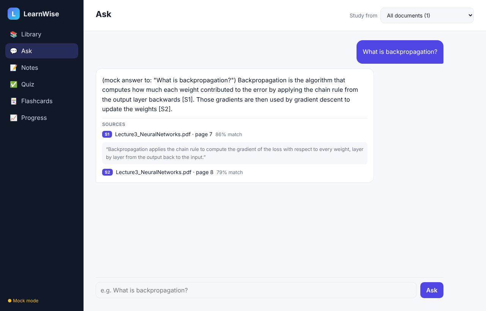

# LearnWise AI

A study assistant that turns your own lecture PDFs and slides into **grounded answers with page references**,
**notes**, **quizzes**, **flashcards**, **adaptive practice** and a **graded mock exam**, using Retrieval-Augmented Generation (RAG).

Group project by **Rizwan Saeed (23i-3009)** and **Sana Idrees (23i-2039)**, Generative AI course.



---

## Graded mock exam (what makes LearnWise different)

Tools like NotebookLM let you chat with your documents. LearnWise also **tests** you on them:

* **Personalised paper:** weak topics come first and get more questions; topics you haven't been tested on fill the rest.
  With *adaptive* difficulty each topic's level follows your mastery.
* **Timed:** a countdown, auto-submit when time runs out.
* **Marked like an exam:** MCQs (1 mark) are auto-marked; short answers (3 marks) are marked by the LLM against a
  reference answer with a rubric, with feedback and the key points you missed.
* **Graded report:** percentage, letter grade, pass/fail, per-topic breakdown, strengths, weak topics, and what to revise next.
  Results feed back into mastery, so the next exam adapts.

API: `POST /api/exam`, `POST /api/exam/{id}/submit`, `GET /api/exam/{id}/result`, `GET /api/exam/history/{user_id}`
(see [`docs/API_CONTRACT.md`](docs/API_CONTRACT.md) section 8). Code: `backend/app/routers/exam.py`,
`backend/app/services/exam.py`, `frontend/src/pages/Exam.jsx`.

## How it works

```
 Laptop (8 GB RAM, CPU only)                                   Kaggle (free T4 GPU)
┌──────────────────────────────────────────────────────┐      ┌─────────────────────────┐
│ React UI (Vite) ──/api──▶ FastAPI backend             │      │ Ollama + Qwen3-8B (4-bit)│
│                            │                          │      │                         │
│   upload PDF ─▶ PyMuPDF ─▶ chunks ─▶ bge-small ─▶ FAISS│      │                         │
│                                                      │ HTTPS│                         │
│   question ─▶ embed ─▶ FAISS top-k ─▶ prompt ─────────┼─────▶│  /v1/chat/completions   │
│                                     ◀── answer + [S1]─┼──────│  (via Cloudflare tunnel)│
└──────────────────────────────────────────────────────┘      └─────────────────────────┘
```

1. **Ingest:** PyMuPDF pulls text out of each page; we split it into ~800-character overlapping chunks and keep the page number on every chunk.
2. **Embed + index:** a small Sentence Transformers model turns each chunk into a vector; FAISS stores them for fast similarity search.
3. **Retrieve:** a question is embedded the same way and FAISS returns the most similar chunks.
4. **Generate:** the chunks go into a prompt as `[S1] [S2] …`; the LLM answers *only* from them and cites the labels, which we map back to pages.
5. **Validate:** notes, quizzes and flashcards come back as JSON, which we check before showing them.

### Why these choices (short version)

| Choice | Why |
|---|---|
| **FastAPI** | Python (same language as the AI code), automatic interactive docs at `/docs`, request validation for free. |
| **React + Vite** | Fast dev server, simple setup, the proposal already lists React. |
| **PyMuPDF** | Fast, accurate PDF text with page numbers; no Java or heavy OCR needed for text PDFs. |
| **bge-small-en-v1.5** (embeddings) | ~130 MB, runs on a laptop CPU in seconds per document, strong retrieval quality for its size. `all-MiniLM-L6-v2` is an even lighter fallback. |
| **FAISS** | A vector index in a single file; no database server to install. With normalized vectors, inner product = cosine similarity. |
| **Qwen3-8B, 4-bit, on Kaggle** | Open model, good at following instructions and producing JSON. 8B at 4-bit needs ~6 GB of GPU memory, which fits a free T4 but **not** an 8 GB-RAM laptop. No paid API. |
| **Ollama** | One command to download and serve the model, already quantized, with an OpenAI-compatible API. |
| **Cloudflare quick tunnel** | Gives the Kaggle notebook a public HTTPS URL with no account. (ngrok also works; it needs a free token.) |
| **OpenAI-compatible adapter** | The backend only knows `LLM_BASE_URL`. Swap Kaggle for local Ollama or Groq's free tier by editing `.env`, with no code changes. |
| **Mock mode** | Every endpoint returns realistic fake data, so the UI can be built and demoed before the AI parts work. |

---

## Folder structure

```
learnwise/
├── docs/
│   ├── API_CONTRACT.md      # the agreement between frontend and backend (read this first)
│   └── openapi.json         # same contract, machine-readable (generated from backend code)
├── backend/
│   ├── app/
│   │   ├── main.py          # FastAPI app, error format, /api/health
│   │   ├── config.py        # settings from .env
│   │   ├── schemas.py       # request/response models = the contract in code
│   │   ├── routers/         # one file per feature: documents, ask, notes, quiz, exam, flashcards, progress
│   │   ├── services/
│   │   │   ├── llm.py       # pluggable LLM adapter (OpenAI-compatible)
│   │   │   ├── pipeline.py  # extraction, chunking, topics, embeddings, FAISS, retrieval
│   │   │   ├── adaptive.py  # mastery score + weak-topic selection
│   │   │   ├── exam.py      # mock exam: personalised plan, marks, grades
│   │   │   ├── validation.py# cleans/validates LLM JSON
│   │   │   ├── mock.py      # fake data for mock mode
│   │   │   └── store.py     # storage, saved to DATA_DIR/store.json in real mode
│   │   └── prompts/templates.py  # all prompts + few-shot examples
│   ├── tests/               # pytest: mock mode + real path with a fake LLM
│   ├── requirements.txt     # light: enough for mock mode
│   └── requirements-ml.txt  # adds PyMuPDF, sentence-transformers, faiss-cpu
├── frontend/                # React (Vite): Library, Ask, Notes, Quiz, Mock exam, Flashcards, Progress pages
├── eval/
│   ├── run_eval.py          # the evaluation (proposal section 9); writes eval/results/
│   ├── data/                # test lectures, questions with expected pages, hand-marked answers
│   └── user_study.md        # pilot tasks + questionnaire
└── kaggle/
    ├── learnwise_qwen3_server.ipynb  # serves Qwen3 on a Kaggle T4 + opens the tunnel
    └── test_connection.py            # checks your laptop can reach it
```

---

## Setup

You need **Python 3.10+** and **Node.js 18+**.

### 1. Backend (mock mode, nothing heavy)

```bash
cd backend
python -m venv .venv
# Windows:  .venv\Scripts\activate        macOS/Linux:  source .venv/bin/activate
pip install -r requirements.txt
cp .env.example .env          # Windows: copy .env.example .env
uvicorn app.main:app --reload
```

Open <http://localhost:8000/docs> to try every endpoint. Run the tests with `pytest -q`.

### 2. Frontend

In a second terminal:

```bash
cd frontend
npm install
npm run dev
```

Open <http://localhost:5173>. The sidebar shows **Mock mode** in yellow; every page works with fake data.

### 3. LLM on Kaggle (when you want real answers)

1. On Kaggle: **Create → New Notebook → File → Import Notebook** and upload `kaggle/learnwise_qwen3_server.ipynb`.
2. Right panel: **Accelerator → GPU T4 x2**, **Internet → On**.
3. **Run All**. After ~3-5 minutes it prints something like
   `LLM_BASE_URL=https://word-word-word.trycloudflare.com/v1`
4. On your laptop: `python kaggle/test_connection.py https://word-word-word.trycloudflare.com/v1`
5. Put the printed lines in `backend/.env`, restart the backend. The sidebar dot turns green.

Notes:
* The URL **changes every time** the notebook restarts; update `.env` when it does.
* Each account gets about 30 GPU hours a week and 12 hours per session. You have two accounts, so take turns running the server and share the URL with each other.
* Leave the last cell running while you work; stop the session when you're done.
* Don't share the URL publicly; anyone with it can use your GPU.

### Run modes (`backend/.env`)

| `USE_MOCKS` | `MOCK_RETRIEVAL` | What happens | Use it for |
|---|---|---|---|
| `true` | (ignored) | Everything fake, no LLM needed | UI work, demos |
| `false` | `true` | Real LLM, fake retrieved passages | Prompt work before retrieval is done |
| `false` | `false` | Fully real pipeline | The final system |

For the fully real pipeline, install the ML packages once: `pip install -r requirements-ml.txt`
(the first upload downloads `bge-small-en-v1.5`, about 130 MB). Uploaded files, the vector index
(`data/index/`) and your library, progress and exam history (`data/store.json`) are saved under `DATA_DIR`,
so restarting the backend keeps them. Delete the `data/` folder to start fresh.

### Switching LLM provider

Only `.env` changes:

| Provider | `LLM_BASE_URL` | `LLM_MODEL` | `LLM_API_KEY` |
|---|---|---|---|
| Kaggle (this repo) | `https://xxxx.trycloudflare.com/v1` | `qwen3:8b` | `not-needed` |
| Ollama on a laptop* | `http://localhost:11434/v1` | `qwen3:1.7b` | `not-needed` |
| Groq free tier (backup) | `https://api.groq.com/openai/v1` | `qwen/qwen3-32b` | your Groq key |

\* With 8 GB RAM only a very small model is realistic locally; it's useful for quick tests, not for quality.

---

## Evaluation

```bash
python eval/run_eval.py              # full system (Kaggle LLM + bge-small), from the learnwise/ folder
python eval/run_eval.py --offline    # no GPU or downloads: checks the plumbing only
```

It measures retrieval (Hit@k, MRR), grounding (% of answer sentences supported by the cited passages, correct
page cited, refusals on out-of-scope questions), quiz validity, mock-exam marking against human marks, and
response times, and writes report-ready tables to `eval/results/`. See [`eval/README.md`](eval/README.md) for the
test set, the metrics and a write-up template.

## Work split

The API contract (`docs/API_CONTRACT.md`) is the boundary. Each person can work and test alone using mock mode;
change the contract only after agreeing together.

### Rizwan: ingestion, retrieval, RAG, endpoints, LLM integration

| # | Task | Where |
|---|---|---|
| 1 | ✅ Extract text per page from PDF (PyMuPDF) and PPTX (python-pptx, incl. tables and speaker notes) | `services/pipeline.py: extract_pages` |
| 2 | ✅ Chunk with overlap at sentence boundaries, keep page numbers | `chunk_pages` |
| 3 | ✅ Embed chunks with `bge-small-en-v1.5`, build and save a FAISS index | `index_chunks` |
| 4 | ✅ Retrieval: embed the query, top-k search, filter by document, drop weak matches (`MIN_SCORE`) | `retrieve` |
| 5 | ✅ Topic detection for the dropdowns (slide/page titles) | `detect_topics` |
| 6 | Run the Kaggle server, connect via `LLM_BASE_URL`, measure response times (`python eval/run_eval.py` reports them) | `kaggle/`, `services/llm.py` |
| 7 | ✅ Persist documents, progress, quizzes and exams (JSON) so a restart doesn't lose them | `services/store.py` |
| 8 | ✅ Delete a document's vectors and file on `DELETE /api/documents/{id}` | `routers/documents.py` |

Still to do: task 6 (measure response times on Kaggle) and pick the shared test lectures.

### Sana: prompts, validation, UI, adaptive practice, evaluation

| # | Task | Where |
|---|---|---|
| 1 | Improve prompts and few-shot examples for notes, quiz, flashcards, grading | `prompts/templates.py` |
| 2 | ✅ Stronger JSON validation (duplicate/empty options, "A)" prefixes, repeated questions); answer-supported-by-passage is measured in `eval/` | `services/validation.py` |
| 3 | UI polish: loading states, empty states, mobile layout (✅ `[S1]` citations are clickable tags in Ask and Notes) | `frontend/src/` |
| 4 | ✅ Adaptive logic: recency (spaced review) and difficulty per topic; the mock exam weights questions by mastery | `services/adaptive.py` |
| 5 | ✅ Evaluation: test set + `eval/run_eval.py` (grounding, retrieval, quiz validity, exam marking, response time) and `eval/user_study.md`. Still to do: run it with the real model, run the pilot | `eval/` |

Use `USE_MOCKS=false` + `MOCK_RETRIEVAL=true` to work on prompts with the real model before Rizwan's retrieval is ready.

### Together

* Agree on contract changes, then update `schemas.py`, `docs/API_CONTRACT.md` and run `python scripts/export_openapi.py`.
* Pick 2-3 real lecture PDFs as the shared test set early.
* Final report and demo.

---

## Putting it on GitHub

The code lives at <https://github.com/RizwanSaeed379/LearnWise>. Clone it with
`git clone https://github.com/RizwanSaeed379/LearnWise.git`.

Add Sana as a collaborator (repo **Settings → Collaborators**). Work on branches and open pull requests so you can review each other's changes.

---

## Troubleshooting

| Problem | Fix |
|---|---|
| Frontend says *Backend offline* | Is `uvicorn` running on port 8000? |
| `501 not_implemented` | An ML package is missing. Run `pip install -r requirements-ml.txt`. |
| `400` on upload: *No text found* | The PDF is scanned images. OCR isn't supported yet; export a text PDF instead. |
| Answers cite unrelated pages | Raise `MIN_SCORE` in `.env` (e.g. 0.35). |
| `502 llm_error` | Kaggle notebook stopped or the tunnel URL changed. Re-run `test_connection.py`. |
| Answers are slow (>30 s) | First call loads the model; later calls are faster. Lower `top_k` or `max_tokens`, or try `qwen3:4b`. |
| Model returns broken JSON | The adapter retries once. If it persists, tighten the prompt's example in `templates.py`. |
